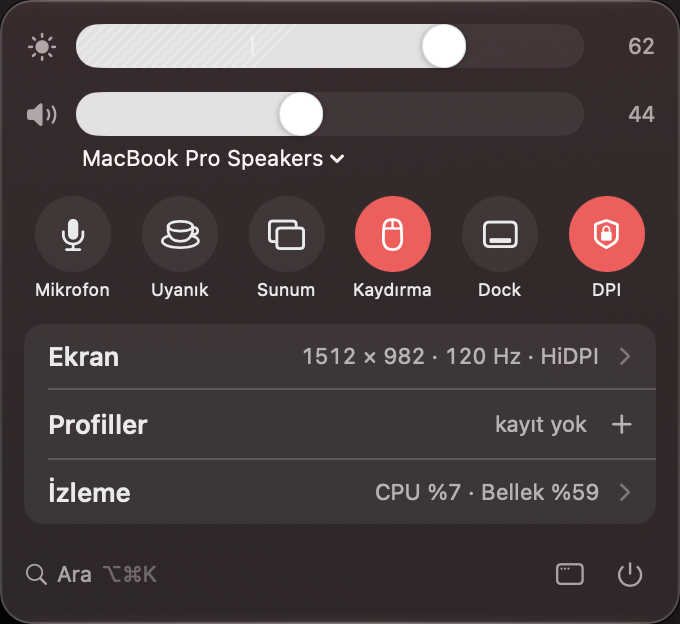
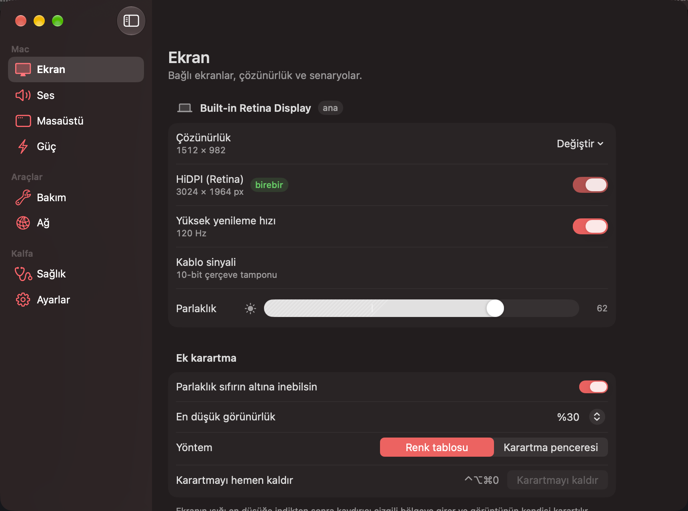
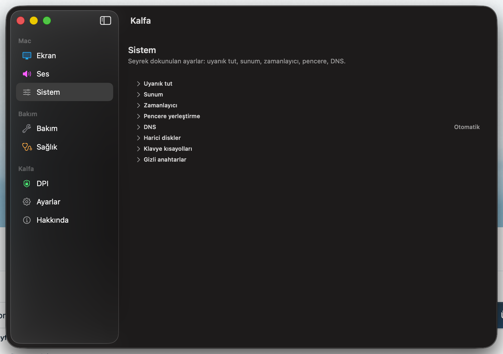
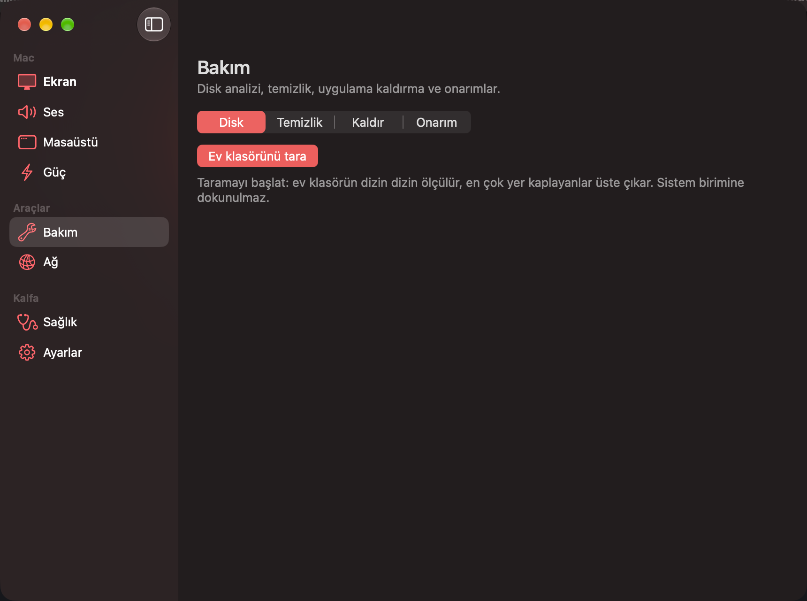
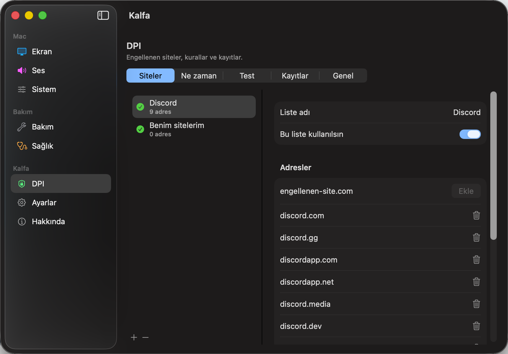
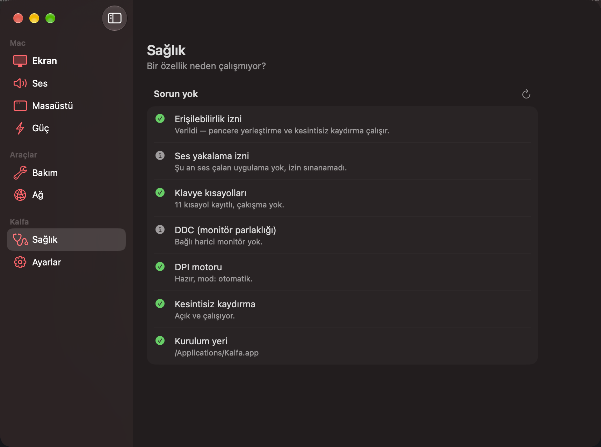

# Kalfa

**Your displays, sound, upkeep and blocked sites — managed from one menu bar icon on macOS.**

Kalfa is a Mac utility that lives in the menu bar. Resolution and HiDPI, monitor
brightness, audio devices, a real system-wide mic mute, keep-awake, presentation
mode, window tiling, disk cleanup, app uninstalling, smooth mouse scrolling and
access to blocked sites — all in the same panel.

*[Türkçe README](README.md)* · macOS 14+ · Swift 6 · MIT

[](https://github.com/aliakpoyraz/kalfa/actions/workflows/ci.yml)
[](https://github.com/aliakpoyraz/kalfa/releases/latest)
[](LICENSE)


**[⬇︎ Download the latest release](https://github.com/aliakpoyraz/kalfa/releases/latest)** —
unzip, move `Kalfa.app` to Applications, then see [first launch](#first-launch-gatekeeper).

<p align="center">
  
</p>

<details>
<summary><b>Contents</b></summary>

- [Why it exists](#why-it-exists)
- [What it does](#what-it-does) — [Displays](#displays) · [Sound](#sound) ·
  [System](#system) · [Upkeep](#upkeep) · [DPI](#dpi--blocked-sites) ·
  [Health](#health) · [Command palette](#command-palette)
- [Keyboard shortcuts](#keyboard-shortcuts)
- [Smooth scrolling](#smooth-scrolling) · [Dock position](#dock-position)
- [Under the hood](#why-it-reads-the-window-servers-private-mode-list)
- [Install](#install) · [Permissions](#permissions) · [FAQ & troubleshooting](#faq--troubleshooting)
- [Diagnostics](#diagnostics) · [Architecture](#architecture) · [Development](#development)
- [Credits](#credits) · [License](#license)

</details>

---

## Why it exists

Setting a Mac up the way you like usually means five or six separate menu bar
apps: one for resolution, one with a coffee cup to stop sleep, one to fix wheel
scrolling, one for disk cleanup, one for blocked sites. Separate icons, separate
settings windows, separate updates, separate permission prompts.

Kalfa puts those jobs in one app: one icon, one place for settings, permissions
granted once.

It started as **Klapa**, written for one specific failure: close a MacBook's lid
to drive an external monitor, and the desktop stops being Retina. macOS quietly
stops offering the HiDPI mode it was using a moment earlier, and System Settings
has no way to get it back. The DPI half came from **ezDPI**; both were merged on
17 September 2026 into one app.

| Situation | Without Kalfa | With Kalfa |
|---|---|---|
| Lid closed, external monitor stops being Retina | macOS no longer lists the mode | Finds it in the window server's own list and applies it |
| Muting the mic in a meeting | Whichever app is in front has its own button | ⌥⌘M, system-wide, the device itself |
| Tidying up before presenting | Hide Dock, hide icons, stop sleep — by hand | One switch; everything comes back on exit |
| Disk is full | Guessing what takes the space | Measures your home folder in ~13 s, biggest first |
| Uninstalling an app | Drag to Trash, leftovers stay | Finds leftovers by bundle ID, moves them to Trash |
| A blocked site | A VPN that slows all traffic | Kicks in only for the domains you list |
| The wheel scrolls in jumps | Install another app | One switch |
| The Dock escapes to the laptop screen | No macOS setting for it | Pin it to the main display |

---

## What it does

### Displays



| | |
|---|---|
| **Every resolution mode** | Merges the CoreGraphics list with the window server's own, longer one |
| **Hidden HiDPI modes** | The Retina modes macOS withholds when the lid is closed |
| **Refresh rate** | Submenu per resolution, plus a high/60 Hz switch |
| **Pixel-grid check** | Labels every mode `pixel for pixel` / `clean 2×` / `scaled · soft` |
| **Native timing marker** | Says when the active mode is one macOS synthesized rather than one the monitor advertises |
| **Cable signal readout** | Colour format and framebuffer bit depth, e.g. `10-bit YCbCr 4:2:2` |
| **Layout profiles** | Saved per set of connected panels; can also carry audio output, DPI mode and keep-awake |
| **DDC/CI brightness + contrast** | Apple Silicon, via `IOAVService` |
| **Confirm-or-revert** | Unverified modes roll back after 15 seconds unless kept |

### Sound

- Pick output and input devices from a menu, set both levels.
- **Per-device volume memory** — back on your headphones, back at their level.
- **A real system-wide mic mute** — the device, not one app's button; a menu bar
  indicator shows while muted.
- **Per-app volume mixer** (macOS 14.2+).

### System



- **Keep awake** — for a time or until turned off, plus "never sleep while these apps run".
- **Presentation mode** — hides the Dock and desktop icons, dims other displays,
  prevents sleep; everything is restored when you turn it off or quit.
- **Timer** — sleep, display off or shut down after a delay.
- **Window tiling** — halves, centre, fill; with keyboard shortcuts.
- **DNS** — applied to every connected network service.
- **Eject external disks**, **hidden switches** (Finder hidden files, screenshot
  format and folder, Dock delay), **keyboard shortcuts**, **Dock position**.

### Upkeep



- **Disk analysis** — walks your home folder directory by directory: 1.01 million
  files / 180 GB in **13 seconds** here. Counted like `du` (allocated blocks, hard
  links once, symlinks not followed).
- **Cleaning** — caches, logs, build output, crash reports, installers. Only things
  the system regenerates by itself come pre-ticked.
- **Uninstaller** — leftovers are matched by bundle ID, never by name.
- **Repairs** — five jobs, each fixing one real symptom:

  | Job | When | Admin |
  |---|---|---|
  | Flush the DNS cache | A site moved servers but your Mac still goes to the old one | ✓ |
  | Repair the Open With list | Removed apps still in the menu, wrong file icons | |
  | Reset Quick Look | Space-bar preview shows an old version | |
  | Restart Finder and Dock | Stuck windows, icons that won't refresh | |
  | Rebuild the Spotlight index | Search finds nothing (takes hours) | ✓ |

> **Nothing is deleted — everything goes to the Trash** (`FileManager.trashItem`),
> so Finder's *Put Back* undoes it. One gate (`Safety.swift`) decides what may be
> touched, and 15 tests exercise it.
>
> **Deliberately absent:** `purge` or any "free up RAM" button. macOS already manages
> memory; forcing it empty only makes the next access come from disk.

### DPI — blocked sites



Some networks block sites by reading the server name in the TLS handshake. Kalfa
runs a local HTTP proxy and, **only for the domains you list**, writes the first
packet differently: byte chunks, a cut through the server name, TLS record
fragmentation or a random cut. The bytes the server receives are identical.

- **Everything you did not list passes through untouched**, so the proxy can stay
  on and payment pages are unaffected.
- **Rules** switch it on by app, network or time of day.
- **Test** tries each address directly, then through Kalfa, and says what happened
  in a sentence.
- The engine is **Kalfa's own code** — no bundled binary, no child process.

### Health



The one-page answer to "why is this feature not working?" — a missing permission,
a monitor link that dropped to 4:2:2, a shortcut another app took — each row with
the button that fixes it.

### Command palette

Opens from anywhere with a shortcut. Turkish search ignores diacritics:
"cozunurluk" finds "çözünürlük".

---

## Keyboard shortcuts

All system-wide; change or disable them under **System → Keyboard shortcuts**.

| Shortcut | Action |
|---|---|
| <kbd>⌥</kbd><kbd>⌘</kbd><kbd>K</kbd> | Open the command palette |
| <kbd>⌥</kbd><kbd>⌘</kbd><kbd>M</kbd> | Mute / unmute the microphone (system-wide) |
| <kbd>⌃</kbd><kbd>⌥</kbd><kbd>←</kbd> / <kbd>→</kbd> | Tile the front window left / right |
| <kbd>⌃</kbd><kbd>⌥</kbd><kbd>↑</kbd> / <kbd>↓</kbd> | Top / bottom half |
| <kbd>⌃</kbd><kbd>⌥</kbd><kbd>C</kbd> | Centre |
| <kbd>⌃</kbd><kbd>⌥</kbd><kbd>↩</kbd> | Fill the screen |

---

## Smooth scrolling

Off by default, and the only feature that asks for a permission: reading the
scroll wheel means an event tap, and an event tap means Accessibility.

What it does is replace a detent's single jump with the same distance spread
over the next frames, played back on the display's own vertical sync. Its
behaviour is modelled on [Mos](https://github.com/Caldis/Mos) — a floor under
how far one detent travels, a two-stage filter rather than a single decay, the
gesture's own event reposted to the process under the pointer, and no scroll
phases (they make apps add a second layer of inertia). Mos is licensed CC BY-NC,
so none of its code is here; this is a separate implementation of what it does.

Trackpads and the Magic Mouse are passed straight through — they already scroll
in pixels, and re-animating them would fight the driver's own inertia.

---

## Dock position

macOS moves the Dock to whichever display the pointer presses against the Dock
edge of. With a laptop under an external monitor, that edge is the laptop's
bottom — exactly where the pointer lands when pushed down — and turning off
"Displays have separate Spaces" no longer stops it.

The **Dock lock** tile in the panel cycles three modes (also under System >
Hidden switches):

| Mode | What it does |
|---|---|
| **Off** | macOS's own behaviour |
| **Main display** | Pointer moves in a 10-point band along other displays' Dock edge never reach the Dock, so it stays on the main display |
| **On edge touch** | Touch the Dock edge of any display to bring the Dock there; no push needed |

Kalfa never moves the pointer in any mode. Stretches of an edge that another
display continues past (the monitor's bottom above a laptop) count as doorways
and are left alone.

The method comes from [DockAnchor](https://github.com/bwya77/DockAnchor): a
session-level tap that only ever drops events. A first attempt tapped at the HID
level and warped the pointer back from the callback; the warp waits on the
window server while the window server waits on the tap, and every display froze.

---

## Why it reads the window server's private mode list

`CGDisplayCopyAllDisplayModes` only returns modes carrying IOKit's "safe" flag.
SkyLight — the window server — keeps a longer list, and the modes it withholds
on a clamshell MacBook are the ones worth having.

Measured on a MacBook Pro driving an MSI MAG 274QF with the lid closed:

```
CoreGraphics :  139 modes — largest HiDPI is 1280 × 720 (2560 × 1440 px)
SkyLight     :  304 modes — including 2560 × 1440 HiDPI (5120 × 2880 px) at 180 Hz
```

That missing mode is the entire problem. Kalfa finds it in SkyLight's list and
applies it with `CGSConfigureDisplayMode`, staged inside a normal
`CGDisplayConfiguration` transaction so it is atomic and honours the same
persistence rules as any other mode change.

These modes lack the "safe" flag, so selecting one arms a 15-second
**"Does the picture look right?"** countdown. Say nothing and the previous mode
comes back.

---

## The pixel-grid check

A HiDPI switch keeps the logical desktop size and only changes the backing
store. Which combination you land on decides how sharp the result is:

| Logical | Backing store | On a 2560 × 1440 panel | |
|---|---|---|---|
| 2560 × 1440 | 2560 × 1440 | 1:1 | **pixel for pixel** |
| 2560 × 1440 | 5120 × 2880 | exact 2× downscale | **clean 2×** |
| 1920 × 1080 | 3840 × 2160 | 1.5× fractional downscale | **scaled · soft** |

The third row is easy to select by accident and is the usual reason "HiDPI
looks blurry". Kalfa labels every mode and offers a one-click jump to the
sharpest option when you are on a fractional one.

---

## The cable signal readout

The row is deliberately read-only:

```
Cable signal
10-bit YCbCr 4:2:2 · 10-bit framebuffer
```

`YCbCr 4:2:2` halves horizontal colour resolution. Text edges soften and can
fringe. On the machine this was developed against, the link runs 8-bit
YCbCr 4:4:4 with the lid open and 10-bit YCbCr 4:2:2 with it closed — same
resolution, same refresh rate.

**There is no supported way to change this.** It was checked properly:

- No display mode advertises anything but 8 bits per channel, so the mode is not
  the lever.
- HDR is off (EDR reports 1.0), so it is not HDR forcing a 10-bit framebuffer.
- Lowering the refresh rate to 165, 144 or 120 Hz does not change the format, so
  it is not link bandwidth.
- SkyLight exports `SLSGetDisplayPixelEncodingOfLength` and
  `SLSCopyDisplayModePixelEncoding` — getters only. There is no setter.
- DDC/CI has no standard VCP code for link pixel encoding.

So Kalfa reports the value instead of pretending to control it. If yours is
subsampled, the things that can actually help are the monitor's own OSD (DisplayPort
version / input colour format), a different cable, or a different port.

---

## Install

### Prebuilt

1. Download `Kalfa-<version>.zip` from
   [Releases](https://github.com/aliakpoyraz/kalfa/releases/latest).
2. Optionally verify it: `shasum -a 256 Kalfa-*.zip` must match the `.sha256` file.
3. Unzip and move `Kalfa.app` to **/Applications** (over the old one, if any).

#### First launch (Gatekeeper)

The package is not notarised yet. On macOS 15 and later **right-click → Open no
longer works**; instead:

1. Double-click Kalfa once — macOS will block it.
2. Open **System Settings → Privacy & Security**.
3. Next to "Kalfa was blocked", click **Open Anyway**.

Only needed the first time.

### From source

```bash
brew install xcodegen
git clone https://github.com/aliakpoyraz/kalfa.git
cd kalfa
./build.sh
cp -R dist/Kalfa.app /Applications/
```

Xcode is required; the Command Line Tools alone cannot build an app bundle.
`build.sh` sets `DEVELOPER_DIR` itself.

**Requirements:** macOS 14 or later. Apple Silicon for DDC brightness; everything
else works on Intel too.

Ad-hoc signing has a cost: the Accessibility grant is tied to the signature, so
every rebuild loses it until it is granted again. A real certificate ends that.

### Building a release

```bash
./release.sh 1.1.1
```

Signs, notarises, staples and produces `dist/Kalfa-1.1.1.zip`. Two things are
needed first, once: a **Developer ID Application** certificate and a notarisation
credential stored with `xcrun notarytool store-credentials`. The steps are at the
top of `release.sh`. It uses `ditto` rather than `zip`, which breaks the signature.

**Not on the Mac App Store, and cannot be.** Sandboxing is mandatory there and
most of what Kalfa does is forbidden inside it: the window server's private mode
list (`CGSConfigureDisplayMode` — private API use is a rejection on its own),
`CGEventTap`, the system proxy, scanning and trashing across the home directory,
DDC, AppleScript with administrator rights.

---

## Permissions

Kalfa asks only for what a feature needs, when you first use it.

| Permission | For | When |
|---|---|---|
| **Accessibility** | Smooth scrolling, window tiling, Dock position | First use |
| **Audio capture** | The per-app mixer | When the mixer is first opened |
| **Location** | Reading the Wi-Fi name (macOS counts it as location) | Only if a rule uses a network name |
| **Administrator** | Two repair jobs | When you run them; macOS's own password box, the password never reaches Kalfa |

---

## FAQ & troubleshooting

**Smooth scrolling / Dock lock stopped working after an update.**
Accessibility is tied to the signature, which changes every release. In System
Settings → Privacy & Security → Accessibility, remove Kalfa with **–** and add it
again with **+**. The Health page flags this in red.

**The window does not open, or settings seem to vanish.**
Most likely two copies are running (say, one in /Applications and one in
Downloads). Two processes with the same name send `kalfa://` links to the wrong
one. Quit and delete the extra copy.

**DPI is on but the site still does not open.**
Use DPI → Test. If it fails through Kalfa too, switch the DPI settings from
**Standard** to **Alternative 1** (random cut) or **Alternative 2** (TLS record
fragmentation). Sites blocked by IP cannot be opened by any fragmentation; that
needs a VPN.

**Text looks soft on the external monitor.**
Two separate causes, both shown on the Displays page: a fractional scale (the mode
says *scaled · soft* — pick a *clean 2×* one), or a link that dropped to YCbCr
4:2:2 (not changeable from software; see [the cable signal readout](#the-cable-signal-readout)).

**Did cleaning delete something by mistake?**
No — Kalfa moves to the Trash. Use Finder's **Put Back**.

**Removing Kalfa completely.**
Trash the app, and optionally `~/Library/Application Support/Klapa`,
`~/Library/Application Support/ezDPI` and
`~/Library/Preferences/com.aliakpoyraz.kalfa.plist`. Kalfa restores the system proxy
when it quits; if anything is left, turn it off under System Settings → Network →
Details → Proxies.

---

## Diagnostics

```bash
/Applications/Kalfa.app/Contents/MacOS/Kalfa --dump
```

Prints every connected display, its active mode, the cable signal, the DDC
reading, and the full mode list with IOKit flags. It calls out an active mode
that is not the panel's native timing.

```
MAG 274QF
  displayID   3
  uuid        A1B2C3D4-0000-0000-0000-000000000000
  active mode 2560 × 1440 (5120 × 2880 px)       180 Hz   [HiDPI,skylight-only,unverified] id=193
  native mode 2560 × 1440 (2560 × 1440 px)       180 Hz   [native] id=130
  link        10-bit YCbCr 4:2:2
  DDC         brightness 100% (100/100), contrast 75% (75/100)
```

---

## Profiles

Stored as plain JSON at `~/Library/Application Support/Klapa/profiles.json` —
the folder keeps its old name so the rename to Kalfa orphans nobody's profiles.
The DPI half keeps its own rules in `~/Library/Application Support/ezDPI/` for
the same reason.

A profile is keyed by **layout**: the sorted set of connected panel UUIDs. This
is the same key macOS uses for its own per-arrangement display settings, which
is why lid-open and lid-closed are two separate records and why one can be
correct while the other is wrong.

Modes are stored by geometry, never by `IODisplayModeID` — the window server
renumbers those after a reconfiguration, so a stored ID goes stale.

---

## Architecture

```
Kalfa/
  Core/        ScreenMode · ScreenInfo · DisplaySetKey · L10n · Watchdog · Diagnostics
  Services/    ModeService     CoreGraphics enumeration and application
               SkyLightModes   the private mode list
               LinkInfo        cable signal and framebuffer readings
               DisplayCenter   state, reconfiguration callback, auto-apply
               ProfileStore · DDCService · AppSettings · LaunchAtLogin
               ScrollService   the wheel event tap and its pixel playback
               DockLockService the pointer tap that keeps or moves the Dock
  Views/       RootView (the panel) · KalfaWindowView (the one window)
               DisplayCardView · ModePickerView · ScaleToggleView · LinkRow
               DDCControlsView · ProfilesSectionView · SaveProfileView
               SettingsView · ScrollSettingsView · AboutView · HealthView
  Bridging/    IOAVService and CGS declarations

Packages/KalfaUI/    the shared visual language and the string lookup
Packages/UpkeepKit/  the upkeep half: sampling, disk scan, cleaning, uninstalling
Packages/EzDPIKit/   the DPI half, as its own module
  Core/        Supervisor · Engine (NativeEngine) · SystemProxyController
  Proxy/       ProxyServer · ProxySession · UpstreamSocket · Fragmenter
               TLSClientHello · DoHResolver
  Watchers/    AppWatcher · NetworkWatcher · ScheduleWatcher
  UI/          MenuPanel (the DPI card) · SettingsView (the DPI page)
  Facade.swift what the app target may touch: start, shutdown, URLs, two views
```

There are three surfaces, and a thing lives in exactly one of them: the **panel**
for daily switches, the **window** for work you sit down to do, the **command
palette** for reaching anything by name.

Both halves arrived as separate menu bar apps, and both define a `Log`, a
`Diagnostics`, a `SettingsView` and an `L10n`. The module boundary settles that
without renaming a type on either side; `Facade.swift` is the only public
surface. `KalfaUI` exists so the DPI module can use the same cards and the same
strings as the rest of the app — before it, the two halves looked like two apps
stapled together, because structurally they were.

Every window server call goes through `Watchdog`.
`CGCompleteDisplayConfiguration` can block indefinitely during a
reconfiguration, which is exactly when Kalfa is doing its work, and the menu bar
must not freeze.

### Private API notes

- `CGSConfigureDisplayMode`'s first parameter is a `CGDisplayConfigRef` from
  `CGBeginDisplayConfiguration`, **not** a CGS connection ID. Passing a
  connection ID segfaults inside SkyLight, which dereferences it as the config
  object.
- `CGSGetDisplayModeDescriptionOfLength` expects a 212-byte (`0xD4`) struct.
  Offsets: mode number `0x00`, flags `0x04`, width `0x08`, height `0x0C`,
  depth `0x10`, refresh rate `0xBE` (`uint16`), density `0xD0` (`float`).
- SkyLight exists only inside the dyld shared cache, so `SLS*` symbols cannot be
  linked. They are resolved with `dlopen` + `dlsym` and degrade to "unavailable"
  if missing.
- A `ScrollView` inside a `MenuBarExtra` window resolves to zero ideal height and
  silently swallows its content.

---

## Development

```bash
./build.sh            # Release build → dist/Kalfa.app
./build.sh Debug

(cd Packages/UpkeepKit && swift test)    # safety gates
(cd Packages/EzDPIKit  && swift test)    # proxy, fragmenting, DoH
```

- The Xcode project is generated from `project.yml` by **xcodegen**; the version
  number lives only there (`MARKETING_VERSION`).
- Strings live in `tr.lproj` / `en.lproj`; every key must exist in both.
- CI (`.github/workflows/ci.yml`) builds and runs the offline tests on every push.
- History: [CHANGELOG.md](CHANGELOG.md) (in Turkish).

---

## Not included

Virtual displays, gamma and colour temperature, ICC profile switching, notch
hiding, brightness-key interception, root-only DPI techniques (fake TTL, desync),
and "free up RAM" style fake speed-ups.

## Credits

Kalfa is the merger of two apps by the same author — **Klapa** (displays) and
**ezDPI** (blocked sites) — and learned from these projects:

| Project | Licence | Taken | Not taken |
|---|---|---|---|
| [BetterDisplay](https://github.com/waydabber/BetterDisplay) | Closed source | Which questions a display manager should answer | No code; virtual displays, gamma/ICC, notch hiding left out |
| [FreeDisplay](https://github.com/huberdf/FreeDisplay) | Open source | The idea of reaching the window server's private mode list | Written from scratch |
| [Mos](https://github.com/Caldis/Mos) | CC BY-NC | Scrolling **behaviour** | **No code** — it would have made Kalfa non-commercial |
| [mole](https://github.com/tw93/mole) | GPL-3.0 | The upkeep **feature set** | **No code, strings or rule lists** — it would have forced Kalfa to GPL |
| [DockAnchor](https://github.com/bwya77/DockAnchor) | MIT | The Dock lock method | Code not copied |
| [SpoofDPI](https://github.com/xvzc/SpoofDPI) | Apache-2.0 | The fragmenting approach | Used to be bundled; replaced by Kalfa's own engine on 24.09.2026 |

## License

MIT — see [LICENSE](LICENSE).
