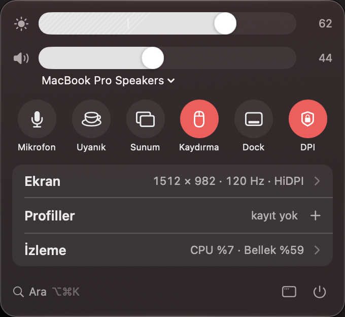
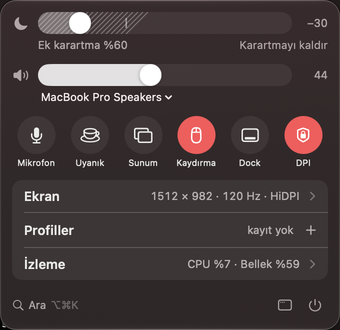
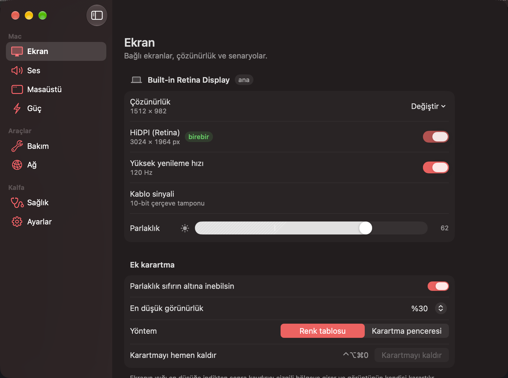
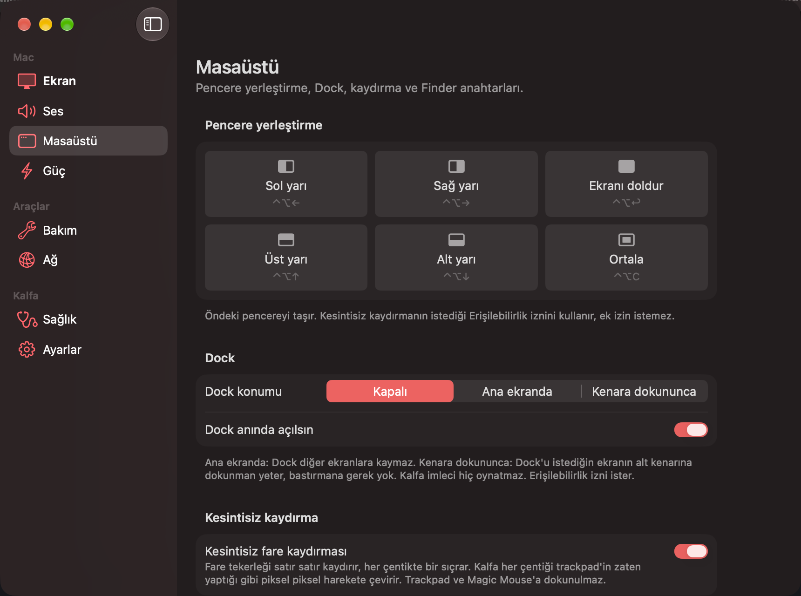
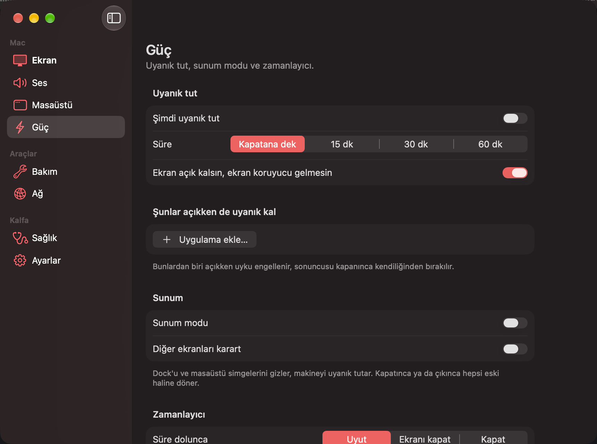
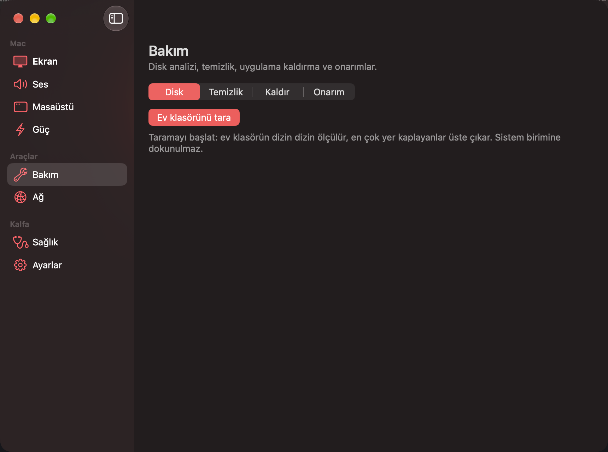
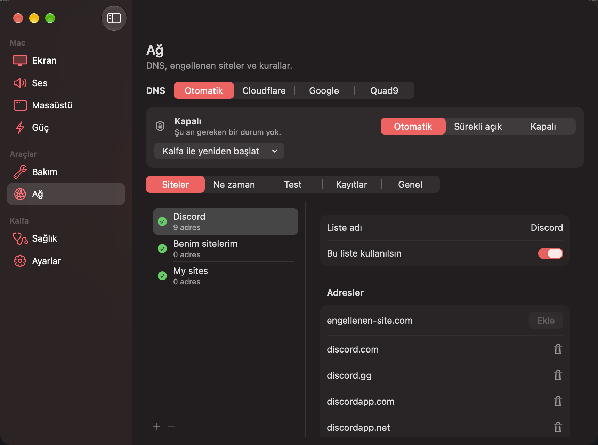
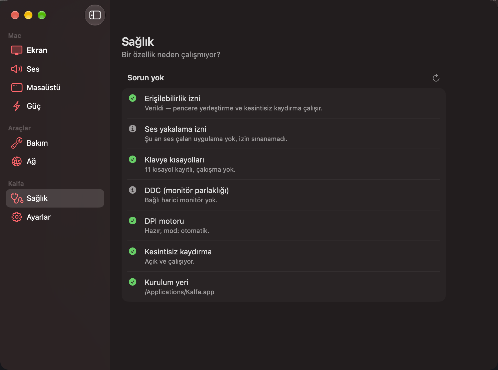

# Kalfa

**macOS menü çubuğundan ekranını, sesini, bakımını ve engellenen siteleri tek yerden yönet.**

Kalfa, menü çubuğunda yaşayan bir Mac aletidir. Ekran çözünürlüğü ve HiDPI, her ekranda
parlaklık (monitörün kendi izin verdiğinden daha karanlığa kadar), ses cihazları,
mikrofon susturma, uyanık tutma, sunum modu, pencere yerleştirme, disk temizliği,
uygulama kaldırma, kesintisiz fare kaydırması ve engellenen sitelere erişim: hepsi tek
panelde, ayarları tek pencerede.

[English](README.en.md) · macOS 14+ · Swift 6 · MIT

[](https://github.com/aliakpoyraz/kalfa/actions/workflows/ci.yml)
[](https://github.com/aliakpoyraz/kalfa/releases/latest)
[](LICENSE)


**[⬇︎ Son sürümü indir](https://github.com/aliakpoyraz/kalfa/releases/latest)** —
zip'i aç, `Kalfa.app`'i Uygulamalar klasörüne taşı. İlk açılış için
[bu adıma](#ilk-açılış-gatekeeper) bak.

<p align="center">
  
  
</p>

Panel bir kumandadır: üstte parlaklık ve ses, ortada altı anahtar, altta içinde açılan
üç konu. Sağdaki görüntüde parlaklık sıfırın altına çekilmiş; ekranın ışığı en düşükte,
görüntü ayrıca karartılıyor.

---

<details>
<summary><b>İçindekiler</b></summary>

- [Neden var](#neden-var)
- [Ne yapar](#ne-yapar) — [Ekran](#ekran) · [Parlaklık](#parlaklık) · [Ses](#ses) ·
  [Masaüstü](#masaüstü) · [Güç](#güç) ·
  [Bakım](#bakım) · [DPI](#dpi--engellenen-siteler) · [Sağlık](#sağlık) ·
  [Kaydırma](#kesintisiz-fare-kaydırması) · [Dock konumu](#dock-konumu) ·
  [Komut paleti](#komut-paleti)
- [Klavye kısayolları](#klavye-kısayolları)
- [Nelerden esinlendi](#nelerden-esinlendi-neler-birleştirildi)
- [Kurulum](#kurulum)
- [İzinler](#izinler)
- [Sık sorulanlar ve sorun giderme](#sık-sorulanlar-ve-sorun-giderme)
- [Teşhis](#teşhis)
- [Mimari](#mimari)
- [Geliştirme](#geliştirme)
- [Kapsam dışı](#kapsam-dışı)
- [Lisans](#lisans)

</details>

---

## Neden var

Bir Mac'i kendine göre ayarlamak için genelde beş altı ayrı menü çubuğu uygulaması
kurarsın: biri çözünürlük için, biri kahve ikonuyla uykuyu engellemek için, biri fare
kaydırmasını düzeltmek için, biri disk temizliği için, biri de engellenen siteler için.
Hepsi ayrı ikon, ayrı ayar penceresi, ayrı güncelleme, ayrı izin kutusu.

Kalfa bu işleri tek uygulamada toplar. Menü çubuğunda tek bir ikon, ayarların tek bir
yerde, izinler bir kez verilir.

**Somut olarak neyi kolaylaştırır:**

| Durum | Kalfa'sız | Kalfa ile |
|---|---|---|
| MacBook kapağı kapalıyken harici monitör Retina olmaktan çıkıyor | macOS o modu listelemiyor, çözüm yok gibi | Pencere sunucusunun gizli listesinden bulup uygular |
| Toplantıda mikrofonu kapatmak | Hangi uygulama öndeyse onun düğmesi | ⌥⌘M ile sistem geneli, gerçek susturma |
| Sunuma girerken masaüstünü toparlamak | Dock'u gizle, simgeleri kaldır, uykuyu kapat — elle, tek tek | Tek anahtar, çıkışta hepsi eski hâline döner |
| Disk doldu | "Neyin yer kapladığını" tahmin etmek | Ev klasörünü 13 saniyede ölçer, en büyükleri sıralar |
| Bir uygulamayı kaldırmak | Uygulamayı çöpe at, kalıntılar diskte kalsın | Paket kimliğiyle eşleşen kalıntıları bulur, çöpe taşır |
| Engellenen bir site | VPN aç, tüm trafiğin yavaşlasın | Yalnız listelediğin adresler için devreye girer |
| Fare tekerleği zıplayarak kaydırıyor | Ayrı bir uygulama kur | Tek anahtar |
| İmleci aşağı indirince Dock laptop ekranına kaçıyor | macOS'ta ayarı yok | Dock ana ekranda kalır ya da yalnız dokunduğun kenara geçer |

---

## Ne yapar

### Ekran



- **Çözünürlük ve HiDPI.** Her modun yanında piksel eşleşmesi etiketi var: *birebir*,
  *tam 2×* ya da *küsuratlı · yumuşak*. Metnin neden yumuşak göründüğünü tahmin etmek
  yerine okuyorsun.
- **Gizli modlar.** macOS'un listelemediği ama pencere sunucusunun bildiği modlar.
  MacBook kapağı kapalıyken 2560 × 1440 HiDPI'nin kaybolması bu yüzden olur; Kalfa o
  modu bulup uygular. Ayrıntı: [Neden özel API](#neden-özel-api-kullanıyor).
- **Onaylı geçiş.** Riskli bir mod uygulandığında 15 saniyelik geri sayım başlar.
  Ekran okunmaz hâle gelirse hiçbir şeye dokunmadan eski moda döner.
- **Parlaklık ve kontrast.** Her ekranda, harici monitörün kendi menüsüne girmeden.
  Ayrıntısı [aşağıda](#parlaklık).
- **Kablo sinyali.** Bağlantının renk biçimi ve bit derinliği (örn. 10-bit YCbCr 4:2:2).
  Salt okunur — macOS bunu seçmek için desteklenen bir yol sunmuyor — ama metnin neden
  yumuşadığını açıklayan ikinci sebep çoğu zaman budur.
- **Profiller.** Ekran düzenine göre kaydedilir; o düzen bağlandığında kendiliğinden
  uygulanabilir. İstersen ses çıkışı, DPI modu ve uyanık tutma durumu da profile girer.

### Parlaklık

Bağlı her ekranın tek bir kaydırıcısı vardır ve ışığı kim yönetiyorsa Kalfa oradan
konuşur:

| Ekran | Yol |
|---|---|
| MacBook'un kendi ekranı, Apple ekranları | Sistemin kendi parlaklığı (parlaklık tuşlarıyla aynı değer) |
| Harici monitör | DDC/CI ile monitörün kendi parlaklığı |
| İkisine de yanıt vermeyen ekran | Yalnız görüntü karartılır; bu, kaydırıcının altında yazar |

**Sıfırın altı.** Kaydırıcının sol üçte biri çizgilidir. Işık en düşüğe indikten sonra
kaydırıcı o bölgeye girer ve görüntünün kendisi karartılır; monitörün menüsünün izin
verdiğinden daha karanlık bir ekran böyle elde edilir. Gece, en kısık ayarı hâlâ fazla
gelen bir monitör içindir.

- **Alt sınır vardır.** Ekran hiçbir zaman seçtiğin en düşük görünürlüğün (%40, %30 ya
  da %20) altına inmez; kaydırıcıyı geri çekemeyeceğin bir siyaha ulaşılamaz.
- **Kendiliğinden geri gelir, kendiliğinden kalkar.** Uyku ve ekran değişiminden sonra
  karartma yeniden kurulur. Kalfa kapanırsa ya da çökerse ekran normale döner. Işığı
  parlaklık tuşlarıyla yükseltirsen karartma da kalkar.
- **Acil çıkış:** <kbd>⌃</kbd><kbd>⌥</kbd><kbd>⌘</kbd><kbd>0</kbd> bütün karartmayı
  kaldırır.
- **İki yöntem.** Varsayılan, her şeyin üstünde duran, tıklamaları geçiren siyah bir
  *karartma penceresi*dir: her ekranda çalışır, ekran görüntülerine ve ekran
  paylaşımına yansımaz, imleç parlak kalır. İkincisi ekranın *renk tablosu*nu
  ölçekler ve imleci de karartır, ama her panel bu tabloyu uygulamaz: MacBook'un
  kendi XDR ekranı yazılan tabloyu kabul eder, geri okutur ve hiçbir şey değişmez.
- <kbd>⌃</kbd><kbd>⌥</kbd><kbd>⌘</kbd><kbd>↓</kbd> / <kbd>↑</kbd> imlecin olduğu
  ekranın parlaklığını bir kademe değiştirir, sıfırda durmaz.

### Ses

- Panelde ses kaydırıcısı ve çıkış seçici; ayrıntı pencerenin Ses sayfasında.
- Çıkış ve giriş cihazını menüden seç, seviyeleri ayarla.
- **Cihaz başına ses hafızası:** kulaklığa geri döndüğünde bıraktığın seviyeyle açılır.
- **Gerçek sistem geneli mikrofon susturma.** Uygulamanın kendi susturması değil,
  cihazın kendisi. Önde hangi toplantı uygulaması olursa olsun çalışır; susturulduğunda
  menü çubuğunda gösterge belirir.
- **Uygulama başına ses karıştırıcı** (macOS 14.2+).

### Masaüstü



- **Pencere yerleştirme** — sol/sağ/üst/alt yarı, ortala, doldur; klavye kısayollarıyla.
- **Dock konumu** — Dock'un hangi ekranda duracağı. Ayrıntısı [aşağıda](#dock-konumu).
- **Kesintisiz kaydırma** — tek anahtar.
- **Gizli anahtarlar** — Finder gizli dosyalar ve uzantılar, ekran görüntüsü biçimi,
  klasörü ve gölgesi, Dock gecikmesi.
- **Harici diskleri çıkar.**

### Güç



- **Uyanık tut** — süreli ya da kapatana dek; "şu uygulamalar açıkken uyuma" kuralıyla.
- **Sunum modu** — Dock'u gizler, masaüstü simgelerini kaldırır, diğer ekranları karartır,
  uykuyu engeller. Kapatınca ve uygulamadan çıkınca hepsi geri gelir.
- **Zamanlayıcı** — belirli süre sonra uyut, ekranı kapat ya da kapat.

### Bakım



- **Disk analizi.** Ev klasörünü dizin dizin ölçer. Bu makinede 1,01 milyon dosya /
  180 GB → **13 saniye**. Treemap yok: sıralı liste + oransal çubuk, her satır tıklanır
  bir hedef.
- **Temizlik.** Önbellek, günlük, derleme çıktısı, çökme raporu, kurulum dosyası.
  Varsayılan olarak **yalnızca makinenin kendi yeniden ürettiği şeyler** işaretli gelir;
  proje çıktıları ve cihaz destek dosyaları işaretsiz durur.
- **Kaldırıcı.** Eşleştirme paket kimliğiyle yapılır, isimle değil — isimle eşleştirmek
  başka uygulamaların verisini yakalıyordu.
- **Onarım.** Her biri tek bir gerçek belirtiyi çözen beş iş:

  | İş | Ne zaman | Yönetici |
  |---|---|---|
  | DNS önbelleğini temizle | Bir site yeni sunucuya taşındı ama Mac eskisine gidiyor | ✓ |
  | Birlikte Aç listesini onar | Kaldırdığın uygulamalar menüde duruyor, dosya ikonları yanlış | |
  | Önizlemeyi sıfırla | Boşluk tuşu önizlemesi dosyanın eski hâlini gösteriyor | |
  | Finder ve Dock'u yeniden başlat | Takılı pencere, güncellenmeyen ikon | |
  | Spotlight dizinini yeniden kur | Arama hiçbir şey bulmuyor (saatler sürer) | ✓ |

  Yönetici gereken işler önceden rozetle işaretlidir; parola Kalfa'ya girmez, macOS'un
  kendi parola kutusu açılır. Kutuyu kapatmak hata değil, vazgeçme sayılır.

> **Silme yok, çöp kutusuna taşıma var** (`FileManager.trashItem`). Fikrini
> değiştirirsen Finder'dan geri koyarsın. Tek istisna çöp kutusunun kendisini
> boşaltmaktır — bir klasör kendi içine taşınamaz — ve bu durumda arayüz kalıcı
> silme olacağını önceden söyler.
>
> Neye dokunulabileceğine tek bir karar noktası bakar (`Safety.swift`): yasak kökler,
> korunan kullanıcı klasörleri, ev dizini sınırı, uygulama paketleri için ayrı kapı ve
> çöp kutusu için ayrı kapı. 15 test bu kapıları sınar — `..` ile dışarı çıkmayı,
> `~` yazımını, komşu dizinlerin önek kazasını ve kalıcı silmenin yalnız tek bir
> yerde bulunduğunu.
>
> **Bilerek yok:** `purge` ya da "RAM temizle" düğmesi. macOS belleği zaten yönetir;
> zorla boşaltmak sonraki erişimi diskten okutur. Klasik yalancı hızlandırıcıdır.

### DPI — engellenen siteler



Pencerenin **Ağ** sayfasındadır; aynı sayfada **DNS** seçimi de durur (bağlı tüm ağ
servislerine uygulanır, Wi-Fi'dan kabloya geçince seninle gelir).

Türkiye'de ve benzeri yerlerde bazı siteler TLS el sıkışması sırasındaki sunucu adına
bakılarak engellenir. Kalfa yerel bir HTTP proxy'si çalıştırır ve **yalnızca senin
listelediğin adresler için** ilk paketi farklı bir şekilde gönderir: bayt bölme, sunucu
adının ortasından kesme, TLS kaydı parçalama ya da rastgele kesim. Sunucuya ulaşan
baytlar birebir aynıdır — değişen yalnızca yazmanın şeklidir.

- **Listelemediğin hiçbir adrese dokunulmaz.** Eşleşmeyen trafik olduğu gibi aktarılır,
  bu yüzden proxy sürekli açık kalabilir ve ödeme sayfaları etkilenmez.
- **Kendiliğinden devreye girer:** bir uygulama açıkken, belirli bir ağdayken ya da
  belirli saatlerde.
- **Test bölümü** her adresi önce doğrudan, sonra Kalfa üzerinden dener ve sonucu cümle
  olarak söyler: *"Engelli ama Kalfa ile açılıyor."*
- Motor **Kalfa'nın kendi kodudur**; pakete gömülü üçüncü taraf ikili yoktur.

> **Yapamadığı:** sahte TTL, sıra dışı segment ve benzeri desync teknikleri. Bunlar ham
> soket ister, o da root ya da Network Extension ister. Kalfa yönetici hakkı istemez.

### Sağlık



"Bu özellik neden çalışmıyor?" sorusunun tek sayfalık cevabı. Her satır sessizce
başarısız olabilen bir şeye karşılık gelir — verilmemiş bir izin, 4:2:2'ye düşmüş bir
monitör bağlantısı, başka bir uygulamanın kaptığı kısayol — ve düzelten düğmeyi taşır.

### Kesintisiz fare kaydırması

Fare tekerleği satır satır kaydırır, her çentikte bir zıplar. Kalfa her çentiği
trackpad'in zaten yaptığı gibi piksel piksel harekete çevirir. Trackpad ve Magic Mouse'a
dokunulmaz. Tek anahtar, ayar kaydırıcısı yok.

### Dock konumu

macOS, imleç hangi ekranın Dock kenarına bastırırsa Dock'u o ekrana taşır. Laptop harici
monitörün altındaysa bu kenar laptopun alt kenarıdır ve imleç aşağı indikçe Dock oraya
kaçar. "Ekranların ayrı alanları var" ayarını kapatmak da artık işe yaramıyor.

Panelde **Dock** anahtarı açıp kapatır; sağ tıklayınca modlar çıkar (Masaüstü
sayfasında da seçilir):

| Mod | Ne yapar |
|---|---|
| **Kapalı** | macOS'un kendi davranışı |
| **Ana ekranda** | Diğer ekranların Dock kenarındaki 10 noktalık şeritte imleç hareketi Dock'a iletilmez; Dock ana ekrandan ayrılmaz |
| **Kenara dokununca** | Dock'u hangi ekranda istiyorsan o ekranın Dock kenarına dokunman yeter, bastırmak gerekmez |

Kalfa imleci hiçbir modda yerinden oynatmaz. Başka bir ekranın devam ettiği kenar
parçaları (laptopun üstündeki monitör kenarı gibi) geçit sayılır, dokunmaya karışmaz.
Erişilebilirlik izni ister; açıldığı anda istenir.

Yaklaşımı [DockAnchor](https://github.com/bwya77/DockAnchor)'dan öğrenildi: olayları
oturum düzeyinde yakalayıp yalnızca düşürmek. İlk denemede olay HID düzeyinde yakalanıp
imleç geri itiliyordu; geri itme çağrısı pencere sunucusunu, pencere sunucusu da olay
dinleyicisini beklediği için bütün ekranlar donuyordu.

### Komut paleti

Kısayolla her yerden açılır, menü çubuğunu hedeflemeye gerek kalmaz. Türkçe arama
Türkçe karakterden bağımsızdır: "cozunurluk" yazınca "çözünürlük" bulunur.

---

## Klavye kısayolları

Hepsi sistem genelidir ve **Ayarlar → Klavye kısayolları**'ndan değiştirilebilir ya da kapatılabilir. Başka bir
uygulama aynı tuşu kaptıysa Sağlık sayfası bunu söyler.

| Kısayol | Ne yapar |
|---|---|
| <kbd>⌥</kbd><kbd>⌘</kbd><kbd>K</kbd> | Komut paletini aç |
| <kbd>⌥</kbd><kbd>⌘</kbd><kbd>M</kbd> | Mikrofonu sustur / aç (sistem geneli) |
| <kbd>⌃</kbd><kbd>⌥</kbd><kbd>←</kbd> / <kbd>→</kbd> | Öndeki pencereyi sol / sağ yarıya yerleştir |
| <kbd>⌃</kbd><kbd>⌥</kbd><kbd>↑</kbd> / <kbd>↓</kbd> | Üst / alt yarı |
| <kbd>⌃</kbd><kbd>⌥</kbd><kbd>C</kbd> | Ortala |
| <kbd>⌃</kbd><kbd>⌥</kbd><kbd>↩</kbd> | Ekranı doldur |
| <kbd>⌃</kbd><kbd>⌥</kbd><kbd>⌘</kbd><kbd>↓</kbd> / <kbd>↑</kbd> | İmlecin olduğu ekranın parlaklığını azalt / artır |
| <kbd>⌃</kbd><kbd>⌥</kbd><kbd>⌘</kbd><kbd>0</kbd> | Ek karartmayı kaldır |

---

## Nelerden esinlendi, neler birleştirildi

Kalfa iki ayrı uygulamanın birleşmesiyle doğdu ve üç açık kaynak projeden ders aldı.
Hangisinden ne alındığı ve ne **alınmadığı** aşağıda açıkça yazılıdır.

### Birleşen iki uygulama

| Uygulama | Neydi | Kalfa'da nerede |
|---|---|---|
| **Klapa** | Ekran yöneticisi: çözünürlük, HiDPI, DDC, profiller | Ekran bölümü ve uygulamanın çekirdeği |
| **ezDPI** | Engellenen sitelere erişim aracı | DPI bölümü (`Packages/EzDPIKit`) |

İkisi de bu deponun yazarına ait, ayrı ayrı çalışan menü çubuğu uygulamalarıydı.
17.09.2026'da tek pakete alındılar; ürün adı **Kalfa** oldu. Her ikisinin de kendi
`Log`, `Diagnostics`, `SettingsView` ve `L10n` tipi olduğu için DPI yarısı ayrı bir
yerel Swift paketi olarak durur — modül sınırı, tek bir tipi yeniden adlandırmadan bu
çakışmayı çözer.

Kullanıcı verisi eski klasörlerinde bırakıldı (`Application Support/Klapa` ve
`ezDPI`): adı güzelleştirmek için taşımak, mevcut kurulumların profillerini ve kural
listelerini sıfırlamak demekti.

### Esinlenilen projeler

| Proje | Lisansı | Ne alındı | Ne alınmadı |
|---|---|---|---|
| [BetterDisplay](https://github.com/waydabber/BetterDisplay) | Kapalı kaynak | Bir ekran yöneticisinin hangi soruları cevaplaması gerektiği | Kod okunmadı; sanal ekran, gamma/ICC ve çentik gizleme kapsam dışı bırakıldı |
| [FreeDisplay](https://github.com/huberdf/FreeDisplay) | Açık kaynak | Pencere sunucusunun gizli mod listesine ulaşma fikri | Uygulama sıfırdan yazıldı |
| [Mos](https://github.com/Caldis/Mos) | CC BY-NC | Kaydırma **davranışı**: çentik başına alt sınır, iki aşamalı süzgeç, girdi önceliği, kaydırma fazı göndermeme | **Tek satır kod kopyalanmadı.** Mos ticari kullanıma kapalı; kod alınsaydı Kalfa MIT olamazdı |
| [mole](https://github.com/tw93/mole) | GPL-3.0 | Bakım **özellik kümesi**: canlı izleme, disk analizi, kaldırıcı, temizlik | **Kod, dize ve kural listesi kopyalanmadı**, davranış sıfırdan yazıldı. Aksi hâlde Kalfa GPL'e geçmek zorunda kalırdı |
| [DockAnchor](https://github.com/bwya77/DockAnchor) | MIT | Dock kilidinin yöntemi: oturum düzeyinde olay dinleyici, kenar şeridinde olayı düşürmek | Kod kopyalanmadı; geçit/duvar ayrımı ve kenara dokunma modu Kalfa'nın |
| [MonitorControl](https://github.com/MonitorControl/MonitorControl) | MIT | Monitörün ışığı bittikten sonra görüntüyü karartarak devam etme fikri | Kod kopyalanmadı; tek ölçek, alt sınır ve geri gelme kuralı Kalfa'nın |
| [SpoofDPI](https://github.com/xvzc/SpoofDPI) | Apache-2.0 | Parçalama yaklaşımının kendisi | Eskiden ikili olarak pakete gömülüydü; **24.09.2026'da çıkarıldı**, yerine Kalfa'nın kendi motoru yazıldı |

Fikir düzeyinde borçlu olunan diğerleri: pencere yerleştirme için **Rectangle** ve
**Magnet**, uyanık tutma için **Amphetamine** ve **KeepingYouAwake**, komut paleti için
**Raycast**, panelin kaydırıcı ve anahtar dili için Apple'ın kendi **Denetim Merkezi**,
pencerenin düzeni için **Sistem Ayarları**. Hiçbirinin
kodu kullanılmadı.

### Lisans neden önemliydi

Kalfa MIT. Bir GPL projesinden kod almak Kalfa'yı da GPL'e zorlar; CC BY-NC'den kod
almak ticari kullanımı kapatır. Bu yüzden mole ve Mos'tan **davranış** alındı,
**kod** alınmadı — ve alınan davranışlar burada, bu tabloda, açıkça yazılıdır.

---

## Kurulum

### Hazır paket

1. [Releases](https://github.com/aliakpoyraz/kalfa/releases/latest) sayfasından
   `Kalfa-<sürüm>.zip` dosyasını indir.
2. İstersen bütünlüğü doğrula: `shasum -a 256 Kalfa-*.zip` çıktısı yanındaki
   `.sha256` dosyasıyla aynı olmalı.
3. Zip'i aç, `Kalfa.app`'i **/Applications** klasörüne taşı (eskisi varsa üzerine).

#### İlk açılış (Gatekeeper)

Paket henüz Apple tarafından noterlenmedi. macOS 15 ve sonrasında **sağ tık → Aç artık
yetmiyor**; doğru yol:

1. Kalfa'yı bir kez çift tıklayıp aç — macOS engelleyecek.
2. **Sistem Ayarları → Gizlilik ve Güvenlik**'e gir.
3. Aşağıdaki "Kalfa engellendi" satırında **Yine de Aç**'a bas.

Bu yalnız ilk açılışta gerekir.

### Kaynaktan derleme

```bash
brew install xcodegen
git clone https://github.com/aliakpoyraz/kalfa.git
cd kalfa
./build.sh
cp -R dist/Kalfa.app /Applications/
```

Xcode gerekir; yalnız Command Line Tools ile uygulama paketi derlenemez. `build.sh`
`DEVELOPER_DIR`'i kendisi ayarlar, `xcode-select`'in neyi gösterdiği önemli değildir.

**Gereksinimler:** macOS 14 veya üzeri. DDC parlaklık için Apple Silicon; geri kalan her
şey Intel'de de çalışır.

Kendi derlediğin paket de ad-hoc imzalıdır; ilk açılış adımı yukarıdakiyle aynı.

> Ad-hoc imzanın bedeli: Erişilebilirlik izni imzaya bağlıdır, yani her yeniden
> derlemede izin düşer ve kesintisiz kaydırma durur. Gerçek bir Developer ID
> sertifikasıyla imzalanmış sürümde bu sorun yoktur.

### Dağıtılabilir sürüm

```bash
./release.sh 1.1.1
```

İmzalar, noterletir, damgalar ve `dist/Kalfa-1.1.1.zip` üretir. Gereken iki hazırlık
(Developer ID sertifikası ve saklanmış noterleme kimliği) `release.sh` dosyasının
başında yazılıdır.

---

## İzinler

Kalfa yalnızca gerçekten gereken izni, gerektiği anda ister.

| İzin | Ne için | Ne zaman |
|---|---|---|
| **Erişilebilirlik** | Kesintisiz kaydırma, pencere yerleştirme ve Dock konumu | İlk kullanıldığında |
| **Ses kaydı** | Uygulama başına ses karıştırıcı | Karıştırıcı ilk açıldığında |
| **Konum** | Wi-Fi ağ adını okumak (macOS bunu konum izni sayar) | Yalnız bir kuralı ağ adına bağlarsan |
| **Yönetici** | Bazı onarım işleri | O işi çalıştırdığında; parola Kalfa'ya girmez, sistemin kendi kutusu açılır |

---

## Sık sorulanlar ve sorun giderme

**Kesintisiz kaydırma / Dock kilidi güncellemeden sonra çalışmıyor.**
Erişilebilirlik izni uygulamanın imzasına bağlıdır ve her sürümde imza değişir.
Sistem Ayarları → Gizlilik ve Güvenlik → Erişilebilirlik listesinde Kalfa'yı
**–** ile sil, **+** ile yeniden ekle. Sağlık sayfası bu durumu kırmızıyla gösterir.

**Pencere açılmıyor ya da ayarlar "kayboluyor".**
Büyük ihtimalle iki Kalfa birden çalışıyor (ör. biri /Applications'ta, biri
İndirilenler'de). Aynı adı taşıyan iki süreç `kalfa://` bağlantılarını yanlış kopyaya
gönderir. Birini kapatıp sil.

**DPI açık ama site hâlâ açılmıyor.**
Ağ → Test bölümünde adresi dene: önce doğrudan, sonra Kalfa üzerinden bağlanıp sonucu
cümleyle söyler. Kalfa ile de açılmıyorsa DPI ayarlarında **Standart** yerine
**Alternatif 1** (rastgele kesim) ya da **Alternatif 2** (TLS kaydı parçalama) dene. IP düzeyinde engellenen
siteleri hiçbir parçalama yöntemi açamaz; o durumda VPN gerekir.

**Ekran çok karanlık kaldı.**
<kbd>⌃</kbd><kbd>⌥</kbd><kbd>⌘</kbd><kbd>0</kbd> ek karartmayı kaldırır; Kalfa'dan
çıkmak da aynı işi görür. Ekran hiçbir durumda seçtiğin en düşük görünürlüğün altına
inmez. Kaydırıcı çizgili bölgedeyken ekran hiç kararmıyorsa Ekran sayfasında yöntemin
*karartma penceresi* olduğuna bak; *renk tablosu* her ekranda etkili değildir.

**Harici monitörde yazılar yumuşak.**
İki ayrı sebebi var, Ekran bölümü ikisini de gösterir: (1) küsuratlı ölçekleme — mod
etiketinde *küsuratlı · yumuşak* yazar, *tam 2×* olan bir moda geç; (2) kablonun
YCbCr 4:2:2'ye düşmesi — yazılımdan değiştirilemez, monitörün kendi menüsünden ya da
farklı bir kablo/port ile çözülür.

**Temizlik bir şeyi yanlışlıkla sildi mi?**
Hayır: Kalfa silmez, çöp kutusuna taşır. Finder'da Çöp Sepeti'nden **Geri Koy**.

**Kalfa'yı tamamen kaldırmak.**
Uygulamayı çöpe at; istersen şu klasörleri de sil:
`~/Library/Application Support/Klapa`, `~/Library/Application Support/ezDPI` ve
`~/Library/Preferences/com.aliakpoyraz.kalfa.plist`. Kalfa kapanırken açtığı sistem
proxy'sini geri alır; yine de bir sorun olursa Sistem Ayarları → Ağ → Ayrıntılar →
Proxy'ler'den kapat.

---

## Teşhis

```bash
/Applications/Kalfa.app/Contents/MacOS/Kalfa --dump
```

Bağlı ekranları, kullanılan modu, kablo sinyalini, DDC okumasını, parlaklığın hangi
yoldan ayarlanacağını ve pencere sunucusunun mod listesini yazdırır.

**URL şeması** — Kısayollar, Raycast ya da kabuk betiğinden:

```bash
open "kalfa://window?section=network" # pencereyi Ağ sayfasında aç
                                      # (displays, audio, desktop, power, upkeep,
                                      #  network, health, settings)
open "kalfa://brightness?level=-20"   # imlecin olduğu ekran: sıfırın 20 altı
open "kalfa://brightness?reset"       # ek karartmayı kaldır
open "ezdpi://on"                     # DPI'yı sürekli açık moda al
open "ezdpi://auto"                   # kural kararı versin
open "ezdpi://relaunch?bundle=com.hnc.Discord"
```

---

## Mimari

```
Kalfa/                  uygulama hedefi — panel, pencere, servisler
Packages/KalfaUI/       paylaşılan görsel dil (kaydırıcı, anahtar, satır, rozet),
                        parlaklık ölçeğinin hesabı ve dize arama
Packages/EzDPIKit/      DPI yarısı: proxy motoru, kural değerlendirme, arayüzü
Packages/UpkeepKit/     bakım yarısı: ölçüm, disk taraması, temizlik, kaldırma
```

Üç yüzey vardır ve bir şey yalnız birinde bulunur: **panel** (günde birkaç kez
dokunulan kaydırıcı ve anahtarlar), **pencere** (bir kez ayarlanıp bırakılanlar, macOS
Ayarlar düzeninde), **komut paleti** (adıyla ulaşma).

Görsel dilin dört kuralı `KalfaDesign.swift`'in başında yazar: renk konuyu değil durumu
anlatır, boşluk ve yazı tek ölçekten gelir, her seçim türünün tek kontrolü vardır.
`scripts/check-design.sh` görünümlerde ölçeğin dışına çıkan boşluk, yazı stili ya da
rengi yakalar; CI'da derlemeden önce koşar.

### Neden özel API kullanıyor

`CGDisplayCopyAllDisplayModes`, MacBook kapağı kapalıyken harici monitörün en iyi HiDPI
modunu listelemiyor — masaüstü Retina olmaktan çıkıyor. Pencere sunucusunun kendi listesi
(304 mod; CoreGraphics 139 tanesini gösteriyor) o modu içeriyor. Kalfa belgelenmemiş
`CGSConfigureDisplayMode` çağrısıyla onu uygular ve bu modlarda güvenlik bayrağı
bulunmadığı için 15 saniyelik onay/geri alma sayacı çalıştırır.

Bunun iki sonucu var: uygulama **Mac App Store'a giremez** (özel API kullanımı tek başına
ret sebebidir) ve macOS'un gelecek bir sürümünde bu çağrı değişebilir.

---

## Geliştirme

```bash
./build.sh            # Release derlemesi → dist/Kalfa.app
./build.sh Debug      # hata ayıklama derlemesi

./scripts/check-design.sh   # görünümler tasarım ölçeğine uyuyor mu

# Testler (ağ gerektirenler dahil)
(cd Packages/KalfaUI   && swift test)    # parlaklık ölçeği: alt sınır, geri gelme
(cd Packages/UpkeepKit && swift test)    # güvenlik kapıları
(cd Packages/EzDPIKit  && swift test)    # proxy, parçalama, DoH
```

- Proje dosyası `project.yml`'den **xcodegen** ile üretilir; `Kalfa.xcodeproj` depoda
  tutulmaz. Sürüm numarası da yalnız oradadır (`MARKETING_VERSION`).
- Yerelleştirme `tr.lproj` / `en.lproj` altındadır; iki dilde de her anahtar bulunmalı.
  Değişkenin sonuna Türkçe ek getiren metinlerden kaçın — ek uyumu güvenle üretilemez.
- CI (`.github/workflows/ci.yml`) her push'ta derler ve ağ gerektirmeyen testleri
  koşturur.
- Değişiklik geçmişi: [CHANGELOG.md](CHANGELOG.md).

---

## Kapsam dışı

- **Mac App Store.** Sandbox zorunludur ve Kalfa'nın yaptığı işlerin çoğu orada yasaktır:
  pencere sunucusunun özel mod listesi, olay dinleyicisi, sistem proxy'si, ev dizini
  genelinde tarama ve çöpe taşıma, DDC, yönetici yetkisiyle betik. Bu kategorideki
  uygulamaların hiçbiri orada değildir.
- Sanal ekran, renk profili (ICC) yönetimi, çentik gizleme. Renk tablosuna yalnızca ek
  karartma için dokunulur.
- Parlaklık tuşlarını (F1/F2) harici monitöre yönlendirmek. Bunun için medya tuşlarını
  olay dinleyicisiyle yakalamak gerekir; Kalfa onun yerine ayrı bir kısayol verir.
- Root gerektiren DPI teknikleri.
- "RAM temizleme" ve benzeri yalancı hızlandırıcılar.

---

## Lisans

MIT — bkz. [LICENSE](LICENSE).

Kaydırma davranışı [Mos](https://github.com/Caldis/Mos) (CC BY-NC) örnek alınarak,
bakım özellikleri [mole](https://github.com/tw93/mole) (GPL-3.0) örnek alınarak
**sıfırdan yazılmıştır**; her iki projeden de kod alınmamıştır. Ayrıntı:
[Nelerden esinlendi](#nelerden-esinlendi-neler-birleştirildi).
